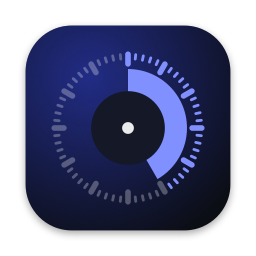
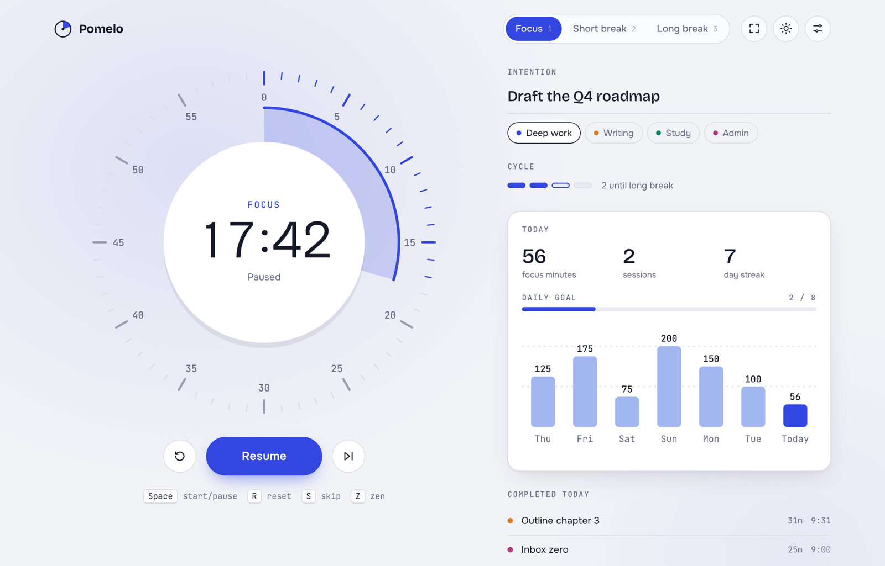
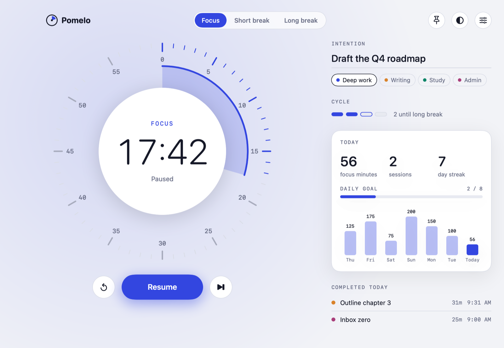
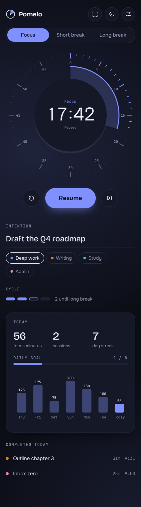
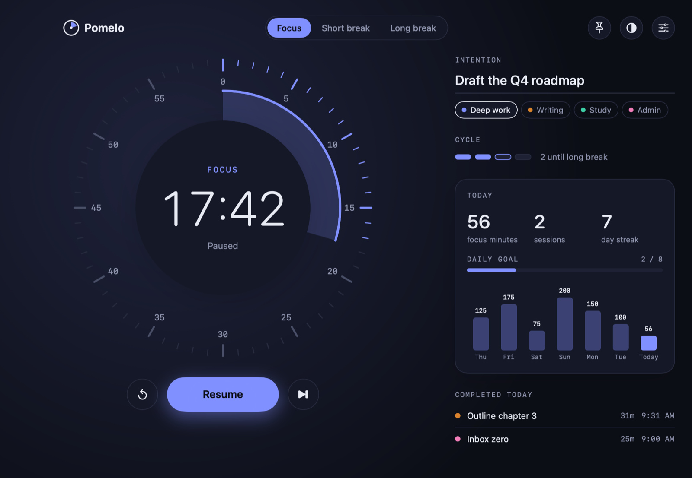
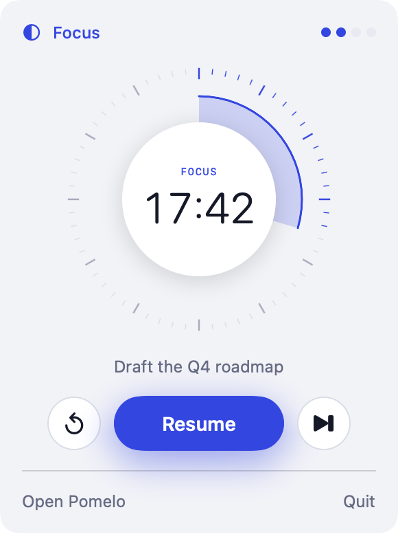
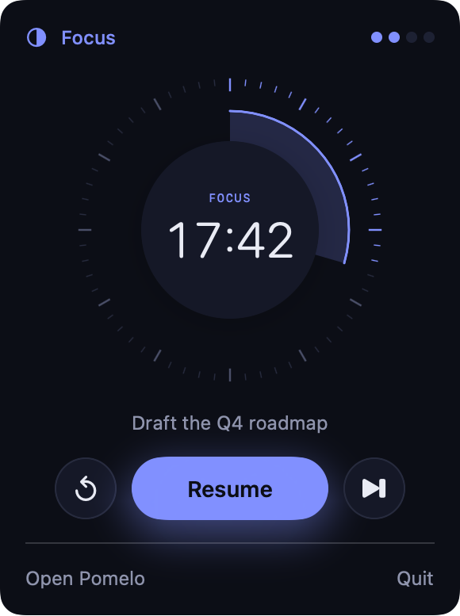

<div align="center">



# Pomelo

**A calm, beautiful Pomodoro timer for the browser and the Mac.**

Drag the dial to set a session, name what you're working on, and let the color of the room tell you whether it's time to focus or rest.

[](https://d-henrique.github.io/pomelo/)
[](https://github.com/D-henrique/pomelo/releases/latest)
[](https://github.com/D-henrique/pomelo/actions/workflows/macos.yml)
[](LICENSE)

[**Open the web app**](https://d-henrique.github.io/pomelo/) · [**Download for macOS**](https://github.com/D-henrique/pomelo/releases/latest) · [Leia em português](README.pt-BR.md)

<br>

<picture>
  <source media="(prefers-color-scheme: dark)" srcset="docs/images/web-dark.png">
  
</picture>

</div>

## Why Pomelo

Most Pomodoro apps are either a bare countdown or a dashboard that wants your attention. Pomelo sits in between. It was designed after studying the best-rated timers on the Mac App Store and keeping only the ideas that actually help you focus:

| Idea | Borrowed from | How Pomelo does it |
| --- | --- | --- |
| Set an intention before you start | Session | A single line above the timer; it shows inside the dial while you work and is saved with the session |
| The whole screen reflects the mode | Session | Focus is blue, a short break is green, a long break is plum; the ambient tint fades between them |
| Physical, direct time setting | Focus Keeper, Time Timer | A 60-minute kitchen-timer dial you drag to set; the wedge shrinks as time runs out |
| Countdown always in view | Flow, Be Focused, Tomito | Live countdown in the menu bar (Mac) and in the tab title (web) |
| Don't stop mid-thought | Session | *Overflow* keeps counting past zero until you choose to finish |
| Stay out of the way | TomatoBar | No account, no tracking, keyboard-first, and a zen mode that hides everything but the dial |

## Features

| | Web | macOS |
| --- | :---: | :---: |
| Drag-to-set 60-minute dial | ✓ | ✓ |
| Focus, short break, long break with automatic cycling | ✓ | ✓ |
| Intentions and tags (Deep work, Writing, Study, Admin) | ✓ | ✓ |
| Overflow mode | ✓ | ✓ |
| Auto-start breaks and focus sessions | ✓ | ✓ |
| Chime when a session ends | ✓ | ✓ |
| Ambient sound during focus (brown noise, soft rain), generated live | ✓ | ✓ |
| Today's minutes, sessions, streak, daily goal and 7-day chart | ✓ | ✓ |
| Light, dark and system themes | ✓ | ✓ |
| Zen mode | ✓ | |
| Menu-bar countdown with a compact control panel | | ✓ |
| System notifications | | ✓ |
| Keeps the display awake during a session | ✓ ¹ | ✓ |
| Keep window on top | | ✓ |

¹ Where the browser supports the Screen Wake Lock API.

## Screenshots

<table>
  <tr>
    <td width="68%"></td>
    <td width="32%" rowspan="2"></td>
  </tr>
  <tr>
    <td></td>
  </tr>
</table>

<p align="center">
  
  &nbsp;&nbsp;
  
</p>

## Get Pomelo

### In the browser

Open **[d-henrique.github.io/pomelo](https://d-henrique.github.io/pomelo/)**. It works on desktop and mobile, with nothing to install.

The web app is a single HTML file with no build step and no dependencies. To run it yourself, open [`web/index.html`](web/index.html) directly, or drop it on any static host.

### On the Mac

1. Download **Pomelo-macOS.zip** from the [latest release](https://github.com/D-henrique/pomelo/releases/latest) and unzip it.
2. Move **Pomelo.app** to your Applications folder.
3. The first time, right-click the app and choose **Open**.

Requires macOS 14 Sonoma or later. It's a universal app, so it runs natively on Apple silicon and Intel.

> [!NOTE]
> Release builds are ad-hoc signed but not notarized by Apple, which is why macOS asks for confirmation on first launch. If you prefer, build it yourself from source; it takes about a minute.

### Build from source

You only need the Xcode Command Line Tools (`xcode-select --install`). Xcode itself isn't required.

```bash
git clone https://github.com/D-henrique/pomelo.git
cd pomelo
./macos/build.sh
open macos/build/Pomelo.app
```

`build.sh` compiles a universal binary with `swiftc`, renders the app icon, writes `Info.plist`, and ad-hoc signs the bundle.

## Keyboard shortcuts

| Action | Web | macOS |
| --- | --- | --- |
| Start / pause / finish | <kbd>Space</kbd> | <kbd>⌘</kbd> <kbd>↩</kbd> |
| Reset | <kbd>R</kbd> | <kbd>⌘</kbd> <kbd>R</kbd> |
| Skip to next | <kbd>S</kbd> | <kbd>⌘</kbd> <kbd>→</kbd> |
| Focus / short break / long break | <kbd>1</kbd> <kbd>2</kbd> <kbd>3</kbd> | <kbd>⌘</kbd> <kbd>1</kbd> <kbd>2</kbd> <kbd>3</kbd> |
| Edit intention | <kbd>I</kbd> | |
| Cycle theme | <kbd>T</kbd> | |
| Zen mode | <kbd>Z</kbd> | |
| Settings | <kbd>,</kbd> | <kbd>⌘</kbd> <kbd>,</kbd> |
| Keep window on top | | <kbd>⇧</kbd> <kbd>⌘</kbd> <kbd>T</kbd> |

## How it works

- **Accurate timing.** The timer stores an end timestamp instead of counting ticks, so it stays exact when the tab is in the background or the Mac sleeps.
- **The cycle.** After every focus session you get a short break; after every fourth (configurable), a long one. Skipping a focus session advances the cycle but doesn't log it.
- **Ambient sound** is synthesized on the fly (Web Audio on the web, `AVAudioEngine` on the Mac), so there are no audio files to download.
- **Stats** show a clearly labeled *Sample week* until you finish your first session, and then only your own data.

## Privacy

Pomelo has no accounts, analytics, or servers. Everything stays on your device:

- **Web:** settings and history live in your browser's `localStorage`. The only network requests are for the Google Fonts typefaces.
- **macOS:** settings and history live in `UserDefaults` on your Mac. The app makes no network requests.

## Project structure

```
pomelo/
├── web/
│   └── index.html          # The entire web app: HTML, CSS and JS, no dependencies
├── macos/
│   ├── Sources/
│   │   ├── App.swift       # App entry: window, menu-bar extra, settings, commands
│   │   ├── Model.swift     # Timer state machine, persistence, stats, ambient audio
│   │   └── Views.swift     # Dial, controls, rail, menu-bar panel, settings UI
│   ├── Scripts/
│   │   └── make_icon.swift # Renders the app icon at every size
│   └── build.sh            # Builds, signs and packages Pomelo.app
├── scripts/                # Regenerates the README screenshots
├── docs/images/            # Screenshots and icon used in this README
└── .github/workflows/      # Pages deploy, macOS build and release
```

## Design

Both apps share one small set of design tokens:

| Token | Light | Dark | Used for |
| --- | --- | --- | --- |
| Focus | `#3346E0` | `#8190FF` | Focus mode, progress, the daily goal |
| Short break | `#0C8467` | `#3ECFA6` | Short break mode |
| Long break | `#A93D7A` | `#F07DB8` | Long break mode |
| Background | `#F2F3F7` | `#0C0E16` | App background |
| Surface | `#FFFFFF` | `#151827` | Dial face, cards |
| Ink | `#151827` | `#E9EBF4` | Primary text |

The web app uses [Bricolage Grotesque](https://fonts.google.com/specimen/Bricolage+Grotesque) for the digits and headings, [Onest](https://fonts.google.com/specimen/Onest) for text, and [JetBrains Mono](https://fonts.google.com/specimen/JetBrains+Mono) for labels. The Mac app uses SF Pro Rounded and SF Mono.

To regenerate the screenshots after a UI change, run `scripts/screenshots.sh`.

## Releasing

1. Update [CHANGELOG.md](CHANGELOG.md) and bump `CFBundleShortVersionString` in `macos/build.sh`.
2. Tag and push:

   ```bash
   git tag v1.1.0
   git push origin v1.1.0
   ```

3. GitHub Actions builds the universal app and publishes a release with the zip and its SHA-256 checksum. Changes under `web/` deploy to GitHub Pages automatically on every push to `main`.

## Roadmap

- Global hotkey to start and pause from any app
- iCloud sync of history between Macs
- Shortcuts actions and a URL scheme (`pomelo://start`)
- Optional distraction blocking during focus
- CSV export of session history

Ideas and pull requests are welcome. See [Contributing](#contributing).

## Contributing

1. Fork the repo and create a branch: `git checkout -b feature/my-idea`.
2. For the web app, edit `web/index.html` and open it in a browser. For the Mac app, run `./macos/build.sh`.
3. Keep both apps consistent: a feature or token change in one should be mirrored in the other where it makes sense.
4. Open a pull request describing the change, with a screenshot for UI changes. CI builds the Mac app on every pull request.

## License

[MIT](LICENSE) © 2026 Doug Moreira
